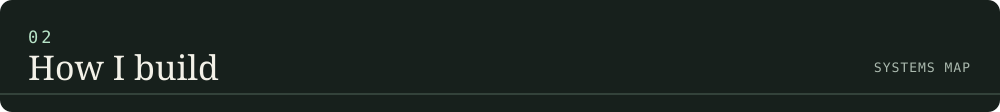
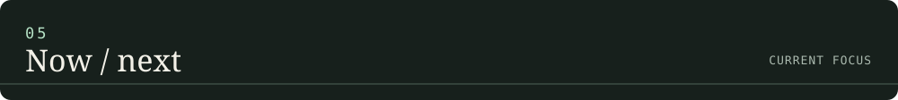

GitHub LinkedIn Website

I’m Aman — a software engineering enthusiast drawn to the space where technical depth meets creative problem-solving.
I like taking an idea from a rough sketch to a working product: understanding the problem, shaping the architecture, building the interface, connecting the data, and refining the details until the pieces feel like one coherent system.
My work and experiments revolve around:
AI engineering — practical LLM applications, local inference, model tooling, and AI-assisted workflows.
Full-stack development — product interfaces, APIs, databases, and end-to-end application flows.
Android development — Kotlin, Jetpack Compose, and mobile-first experiences.
Backend engineering — data modelling, authentication, integrations, and dependable application logic.
Open source — learning in public, sharing useful work, and building on the ideas of others.
I’m interested in more than making software run. I’m interested in making it useful, understandable, and thoughtfully engineered.

  

I enjoy working across the boundaries between disciplines. A product rarely lives in just one layer: a good experience depends on the interface, the API, the data model, and the systems behind it all working together.

01 / NEET CBT MASTERS
An online testing platform for NEET preparation
A product focused on structured practice, computer-based mock tests, and explanations that help students understand the reasoning behind an answer.
Building an AI-assisted question-generation workflow.
Organising chapter-wise and full-length test experiences.
Working on question quality, explanations, and a scalable content pipeline.
Visit NEET CBT MASTERS ↗
02 / MyGPM Student Portal
A connected student-services platform
A collaborative multi-application project designed around student, class-representative, and administrative workflows.
Monorepo structure spanning student app, CR app, admin web, and backend.
Supabase-backed data and application architecture.
Focus on authentication, database design, and maintainable integration boundaries.
Explore the public student-app repository ↗
03 / AutoUPITracker
An Android-first personal finance experiment
An exploration of reducing manual expense tracking by turning payment notifications and transaction signals into organised financial records.
Kotlin and Jetpack Compose.
Transaction categorisation, local persistence, and spending insights.
Exploring automation and OCR-assisted transaction capture.
Project details and implementation are evolving; public source availability may change.
04 / AI & LLM Lab
Experiments at the intersection of models and software
A hands-on space for understanding how language models can become useful components in real developer workflows and products.
Local model experimentation with Ollama and open-weight models.
Exploring inference constraints, quantisation, and GPU memory trade-offs.
AI-assisted coding workflows and agentic developer tools.
Evaluating practical ways to integrate LLMs into applications.

LANGUAGES
Java Kotlin Python JavaScript SQL
APPLICATIONS & FRONTEND
Android Jetpack Compose React HTML5 CSS3
BACKEND, DATA & INFRASTRUCTURE
Supabase PostgreSQL Firebase Docker Git
AI & DEVELOPER TOOLING
Ollama Linux GitHub Actions

Building and refining products with real user workflows.
Exploring practical LLM engineering, local inference, and AI-powered features.
Strengthening backend architecture, API design, and database fundamentals.
Improving the craft of shipping clean, maintainable software.
Looking for meaningful open-source contributions and engineering collaborations.

GitHub: @AmanAgarwal2008
LinkedIn: Aman Agarwal
Product: NEET CBT MASTERS

 
  

