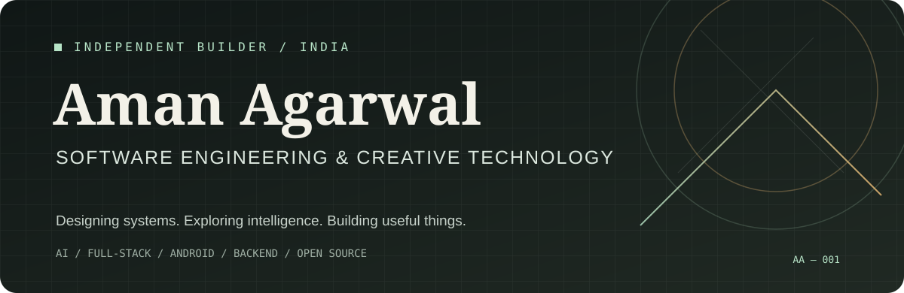
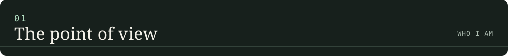
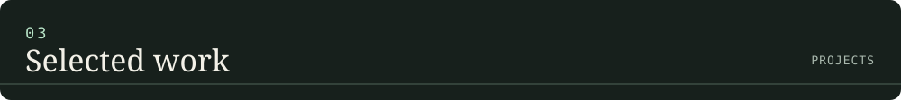
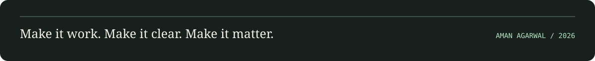

---

I’m **Aman** — a software engineering and creative technology enthusiast interested in building useful products and understanding the systems behind them.

I enjoy moving between disciplines: shaping a product idea, designing its architecture, building the interface, connecting the backend, and experimenting with the tools that make the whole system better.

My interests sit at the intersection of:

- **AI engineering** — practical LLM applications, local inference, model tooling, and AI-assisted workflows.
- **Full-stack development** — web applications, APIs, databases, and end-to-end product experiences.
- **Android development** — Kotlin, Jetpack Compose, and mobile-first application design.
- **Backend engineering** — data modelling, authentication, integrations, and application architecture.
- **Open source** — learning from other builders, exploring tools, and sharing useful work.

> I like software that is technically thoughtful, creatively designed, and genuinely useful.

I approach products as connected systems rather than isolated screens. The quality of an application depends on how well its interface, data, APIs, and underlying logic work together.

### 01 / NEET CBT MASTERS
**An online testing platform for NEET preparation**

A product focused on structured practice, computer-based mock tests, and explanations that help students understand the reasoning behind an answer.

- Developing an AI-assisted question-generation workflow.
- Building chapter-wise and full-length test experiences.
- Working on question quality, explanations, and a structured content pipeline.

[Visit NEET CBT MASTERS ↗](https://www.neetcbtmaster.in/)

### 02 / MyGPM Student Portal
**A connected student-services platform**

A collaborative multi-application project spanning student, class-representative, and administrative workflows.

- Monorepo architecture across student app, CR app, admin web, and backend.
- Supabase-backed data and application architecture.
- Focus on authentication, database design, and maintainable integration boundaries.

[Explore the public student-app repository ↗](https://github.com/AmanAgarwal2008/mygpm-student-app)

### 03 / AutoUPITracker
**An Android-first personal finance experiment**

An exploration of reducing manual expense tracking by turning transaction signals into organised financial records.

- Kotlin and Jetpack Compose.
- Transaction categorisation, local persistence, and spending insights.
- Exploring notification-based capture and OCR-assisted transaction entry.

### 04 / AI & LLM Lab
**Experiments at the intersection of models and software**

A hands-on exploration of how language models can become useful components in developer workflows and real applications.

- Local model experimentation with Ollama and open-weight models.
- Exploring inference constraints, quantisation, and GPU memory trade-offs.
- AI-assisted coding workflows and agentic developer tools.
- Evaluating practical ways to integrate LLMs into applications.

**LANGUAGES**

**APPLICATIONS & FRONTEND**

**BACKEND, DATA & INFRASTRUCTURE**

**AI & DEVELOPER TOOLING**

Some things I’m actively exploring:

- Building practical AI features rather than treating models as standalone demos.
- Understanding local inference, quantisation, and the engineering constraints of running LLMs.
- Improving backend architecture, API design, and database fundamentals.
- Shipping maintainable applications with thoughtful interfaces.
- Finding meaningful open-source tools and opportunities to contribute.

- **GitHub:** [@AmanAgarwal2008](https://github.com/AmanAgarwal2008)
- **Projects:** [Browse repositories](https://github.com/AmanAgarwal2008?tab=repositories)
- **NEET CBT MASTERS:** [neetcbtmaster.in](https://www.neetcbtmaster.in/)

